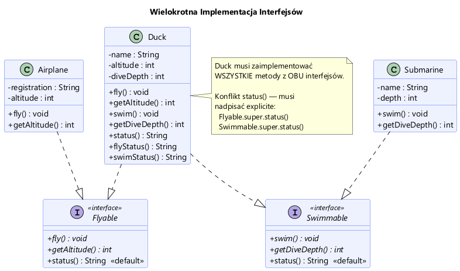

# Moduł 2.2: Implementacja i Wielokrotne Dziedziczenie Interfejsów

## Wprowadzenie

### 🎯 Czego się nauczysz w tym module?
*   Jak zaimplementować **wiele interfejsów** w jednej klasie.
*   Jak radzić sobie z konfliktami nazw (gdy dwa interfejsy mają tę samą metodę).
*   Jak bezpiecznie **rzutować obiekty** na interfejsy (`instanceof`).

W przeciwieństwie do klas, gdzie w Javie dozwolone jest dziedziczenie tylko po jednej klasie ("Single Inheritance"), **klasa może implementować dowolną liczbę interfejsów**.

Jest to potężne narzędzie, pozwalające modelować obiekty posiadające wiele różnych zdolności, np. `Duck` (kaczka), która potrafi zarówno latać (`Flyable`), jak i pływać (`Swimmable`).

---

## Wielokrotna Implementacja (Multiple Inheritance of Type)

Klasa implementująca wiele interfejsów musi zrealizować metody abstrakcyjne każdego z nich.



```java
// Kaczka potrafi latać i pływać
public class Duck implements Flyable, Swimmable {
    @Override
    public void fly() { ... } // z Flyable

    @Override
    public void swim() { ... } // z Swimmable
}
```
Zobacz implementację w [Duck.java](Duck.java).

### Polimorfizm z wielu perspektyw

Jednego obiektu typu `Duck` możemy używać w różnych kontekstach, w zależności od potrzeb:

```java
Duck duck = new Duck("Kaczor Donald");

Flyable asFlyer = duck;      // Używamy kaczki jako "latacza"
asFlyer.fly();

Swimmable asSwimmer = duck;  // Używamy tej samej kaczki jako "pływaka"
asSwimmer.swim();
```
Przykład w [MultiInterfaceDemo.java](MultiInterfaceDemo.java).

---

## Dwa interfejsy z metodą `strzelaj()`

Załóżmy, że zarówno piłkarz, jak i żołnierz mają metodę o tej samej nazwie
i sygnaturze:

```java
interface Pilkarz {
    void strzelaj();
}

interface Zolnierz {
    void strzelaj();
}

class Postac implements Pilkarz, Zolnierz {
    @Override
    public void strzelaj() {
        System.out.println("Postać oddaje strzał");
    }
}
```

Metoda `Postac.strzelaj()` jest jednocześnie implementacją obu metod
interfejsowych. Można wywołać ją przez oba typy:

```java
Postac postac = new Postac();
Pilkarz jakoPilkarz = postac;
Zolnierz jakoZolnierz = postac;

jakoPilkarz.strzelaj();
jakoZolnierz.strzelaj();
```

Oba wywołania uruchamiają tę samą implementację `Postac.strzelaj()`.
Java wybiera implementację na podstawie rzeczywistego typu obiektu, a nie
tego, przez który interfejs (typ referencji) wywołujemy metodę. Nie da się
więc na podstawie samego `strzelaj()` rozpoznać, czy postać ma strzelić do
bramki jako piłkarz, czy do celu jako żołnierz.

Jeśli te czynności mają oznaczać różne zachowania, interfejsy powinny
udostępniać różne operacje, na przykład:

```java
interface Pilkarz {
    void strzelajDoBramki();
}

interface Zolnierz {
    void strzelajDoCelu();
}

class Postac implements Pilkarz, Zolnierz {
    @Override
    public void strzelajDoBramki() {
        System.out.println("Strzał piłką do bramki");
    }

    @Override
    public void strzelajDoCelu() {
        System.out.println("Strzał z broni do celu");
    }
}
```

Można wtedy używać obu ról niezależnie:

```java
Postac postac = new Postac();
postac.strzelajDoBramki();
postac.strzelajDoCelu();
```

Alternatywnie można pozostawić jedną metodę `strzelaj(...)`, ale przekazywać
jej jawnie rodzaj celu jako argument. Kluczowe jest to, że wywołanie musi
przekazać informację odróżniającą oba przypadki — samo rzutowanie obiektu na
`Pilkarz` albo `Zolnierz` nie zmienia działania wspólnej metody.

---

## Bezpieczne rzutowanie i `instanceof`

Często mamy do czynienia z ogólnym typem (np. `Object` lub listą różnych obiektów) i chcemy sprawdzić, czy dany obiekt implementuje konkretny interfejs.

Tradycyjnie w Javie używano operatora `instanceof` i rzutowania:

```java
if (obj instanceof Flyable) {
    Flyable flyer = (Flyable) obj; // Rzutowanie
    flyer.fly();
}
```

Od Javy 16, dzięki **Pattern Matching for instanceof**, możemy to zapisać krócej i bezpieczniej:

```java
if (obj instanceof Flyable flyer) {
    flyer.fly(); // zmienna 'flyer' jest już dostępna i zrzutowana
}
```

O tym dlaczego warto zawsze sprawdzać typ przed rzutowaniem (aby uniknąć `ClassCastException`) dowiesz się z przykładu [CastingDemo.java](CastingDemo.java).

---

## Konflikty nazw metod domyślnych

Dwie identyczne metody abstrakcyjne (takie jak `strzelaj()` powyżej) można
zrealizować jedną metodą klasy. Inaczej jest, gdy dwa interfejsy dostarczają
metodę `default` o tej samej sygnaturze, np. `default String status()`.
Wtedy klasa implementująca **musi** nadpisać tę metodę, aby rozwiązać konflikt.
Może przy tym skorzystać z implementacji domyślnej konkretnego interfejsu,
używając składni `Interfejs.super.metoda()`.

```java
@Override
public String status() {
    // Jawne rozwiązanie konfliktu:
    return "Status kaczki: " + Flyable.super.status() + ", " + Swimmable.super.status();
}
```
Więcej w komentarzach w [Duck.java](Duck.java).

---

## ⚠️ Najczęstsze błędy początkujących

1.  **"Diamond Problem" (zły wybór metody):**
    Gdy implementujesz dwa interfejsy z taką samą metodą default, musisz ją nadpisać w swojej klasie, bo kompilator nie wie którą wybrać.
    `// Wymagane: return Interfejs1.super.metoda();`

2.  **Rzutowanie "na ślepo":**
    Próba rzutowania obiektu na interfejs, którego nie implementuje, kończy się błędem w działaniu programu (`ClassCastException`).
    *Zawsze* używaj `instanceof` przed rzutowaniem!

3.  **Zapominanie o wszystkich metodach:**
    Jeśli klasa implementuje interfejs, musi zrealizować **wszystkie** jego metody abstrakcyjne (chyba że sama jest abstrakcyjna).

---

## 📚 Literatura i materiały dodatkowe

*   **Cay S. Horstmann**, *Java. Podstawy*, Rozdział "Interfejsy".
*   [Dokumentacja Oracle: Pattern Matching for instanceof](https://docs.oracle.com/en/java/javase/16/language/pattern-matching-instanceof.html)

---

## Uruchomienie przykładów

```powershell
.\run-examples.ps1
```
