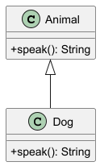

# Moduł 3.1: Pojęcie dziedziczenia i implementacja w Javie

## Wprowadzenie

Dziedziczenie pozwala budować nowy typ na bazie istniejącego typu. W Javie realizujemy to przez `extends`, a główną korzyścią jest wspólny kontrakt `is-a` oraz możliwość ponownego użycia kodu.

### Czego nauczysz się w tym module?
- odróżniania relacji `is-a` od relacji `has-a`,
- projektowania prostych hierarchii klas,
- świadomego użycia `override` w klasie potomnej.

---

## Diagram koncepcji



Diagram PlantUML: [`diagrams/inheritance_intro.puml`](diagrams/inheritance_intro.puml)

---

## Kod i omówienie

Plik z przykładem:
- [`code/InheritanceIntroDemo.java`](code/InheritanceIntroDemo.java)

Fragment:

```java
Animal animal = new Dog();
System.out.println(animal.speak());
```

Wynik pokazuje, że referencja typu bazowego (`Animal`) może wskazywać na obiekt klasy potomnej (`Dog`).

### Co dzieje się krok po kroku?

```java
Animal animal = new Dog();
```

1. `new Dog()` tworzy obiekt typu `Dog`.
2. `animal` jest referencją typu `Animal`, więc przez nią dostępne są tylko
   operacje zadeklarowane w `Animal`.
3. Jeśli `Dog` nadpisuje `speak()`, wywołanie `animal.speak()` uruchomi
   implementację `Dog`. To podstawowy przypadek polimorfizmu.

Dziedziczenie nie oznacza, że klasa potomna może dowolnie zmienić znaczenie
klasy bazowej. `Dog` powinien nadal zachowywać się jak `Animal`; inaczej
hierarchia będzie myląca dla kodu korzystającego z typu bazowego.

### Dziedziczenie a kompozycja

Jeśli `Car` ma silnik, nie oznacza to, że `Car` jest rodzajem `Engine`.
To relacja `has-a`, którą modelujemy polem i delegowaniem, a nie `extends`.
Dziedziczenie opisuje specjalizację, a kompozycja składanie obiektu z innych
obiektów.

---

## Najczęstsze błędy

1. Projektowanie dziedziczenia tylko po to, by współdzielić kod (zamiast przemyślanej relacji `is-a`).
2. Brak `@Override` przy nadpisywaniu metod.
3. Nadmiernie głębokie hierarchie klas, utrudniające utrzymanie.

### Pytania kontrolne

- Jaki jest typ referencji w wyrażeniu `Animal animal = new Dog()`?
- Która metoda zostanie wywołana dla `animal.speak()` i dlaczego?
- Czy relację `Car`-`Engine` lepiej opisać przez `extends`, czy przez pole?

---

## Uruchomienie

Z katalogu `02_OOP/src/_03_dziedziczenie`:

```powershell
.\run-all-examples.ps1
```

---

## Materiały dodatkowe

- Oracle Tutorials: <https://docs.oracle.com/javase/tutorial/java/IandI/subclasses.html>
- Effective Java, rozdział o projektowaniu klas i interfejsów
