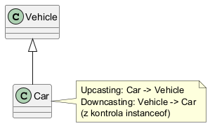

# Moduł 3.2: Zgodność typów w hierarchii dziedziczenia

## Wprowadzenie

W Javie typ referencji może być ogólniejszy niż typ obiektu. To podstawa polimorfizmu i bezpiecznego API. W drugą stronę (downcasting) potrzebna jest ostrożność i najczęściej sprawdzenie `instanceof`.

### Czego nauczysz się w tym module?
- jak działa upcasting i downcasting,
- kiedy rzutowanie jest bezpieczne,
- jak używać `instanceof` z pattern matchingiem.

---

## Diagram koncepcji



Diagram PlantUML: [`diagrams/type_compatibility.puml`](diagrams/type_compatibility.puml)

---

## Kod i omówienie

Plik z przykładem:
- [`code/TypeCompatibilityDemo.java`](code/TypeCompatibilityDemo.java)

Fragment:

```java
Vehicle upcasted = new Car();
if (upcasted instanceof Car car) {
    car.openTrunk();
}
```

To nowoczesny styl Javy (pattern variable `car`) bez ręcznego rzutowania.

### Upcasting i downcasting

Upcasting zachodzi na przykład tutaj:

```java
Vehicle vehicle = new Car();
```

Obiekt `Car` spełnia wymagania `Vehicle`, więc konwersja jest bezpieczna.
Przez `vehicle` widoczny jest jednak tylko kontrakt `Vehicle`; metoda
istniejąca wyłącznie w `Car` wymaga dodatkowego sprawdzenia.

Downcasting próbuje odzyskać bardziej szczegółowy typ:

```java
if (vehicle instanceof Car car) {
    car.openTrunk();
}
```

Warunek sprawdza typ obiektu, a zmienna `car` jest dostępna w bezpiecznym
zakresie. Samo `(Car) vehicle` nie zmienia obiektu i nie gwarantuje sukcesu -
gdy obiekt jest innym `Vehicle`, otrzymamy `ClassCastException`.

Typ referencji decyduje o tym, co można napisać i skompilować. Rzeczywisty typ
obiektu decyduje o implementacji nadpisanej metody instancyjnej. To rozróżnienie
jest fundamentem polimorfizmu.

---

## Najczęstsze błędy

1. Rzutowanie bez sprawdzenia typu (`ClassCastException`).
2. Zakładanie, że typ referencji decyduje o implementacji metody.
3. Nadużywanie `instanceof` zamiast projektowania lepszego API.

### Pytania kontrolne

- Dlaczego `Vehicle vehicle = new Car()` jest legalne?
- Co stanie się przy rzutowaniu `Vehicle` wskazującego na `Bike` do `Car`?
- Czy zamiast downcastingu można dodać potrzebną operację do wspólnego kontraktu?

---

## Uruchomienie

```powershell
Set-Location "C:\home\gitHub\oop-concepts-java\02_OOP\src\_03_dziedziczenie"
.\run-all-examples.ps1
```

---

## Materiały dodatkowe

- JLS, rozdział 5 (Conversions and Promotions): <https://docs.oracle.com/javase/specs/jls/se21/html/jls-5.html>
