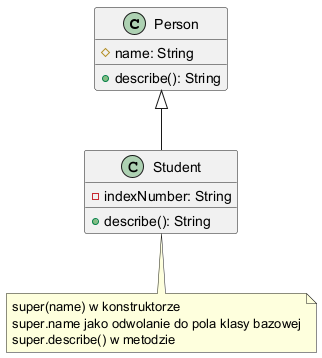

# Moduł 3.3: Słowo kluczowe `super` w praktyce

## Wprowadzenie

`super` pozwala odwołać się do części klasy bazowej: konstruktora, metod i pól. To kluczowe narzędzie przy budowaniu klas potomnych, gdy chcesz rozszerzyć zachowanie zamiast je zastąpić.

### Czego nauczysz się w tym module?
- jak wywoływać konstruktor klasy bazowej,
- kiedy używać `super.method()`,
- jak odwoływać się do pól klasy bazowej przez `super.field`,
- jak unikać błędów inicjalizacji obiektu.

---

## Diagram koncepcji



Diagram PlantUML: [`diagrams/super_usage.puml`](diagrams/super_usage.puml)

---

## Kod i omówienie

Plik z przykładem:
- [`SuperKeywordDemo.java`](code/SuperKeywordDemo.java)

Fragment:

```java
Student(String name, String indexNumber) {
    super(name);
    this.indexNumber = indexNumber;
}

@Override
String describe() {
    String inheritedName = super.name;
    return super.describe() + ", inheritedName=" + inheritedName + ", index=" + indexNumber;
}

String describeWithFieldReference() {
    return "Student(super.name=" + super.name + ", index=" + indexNumber + ")";
}
```

Najpierw inicjalizowana jest część klasy bazowej, dopiero później pola klasy potomnej.

Wywołanie konstruktora klasy bazowej musi być pierwszą instrukcją konstruktora
klasy potomnej. Jeżeli nie napiszesz `super(...)`, Java spróbuje wstawić
`super()`. Zadziała to tylko wtedy, gdy klasa bazowa ma dostępny konstruktor
bezargumentowy. Dodanie własnego konstruktora w klasie bazowej może więc
ujawnić błędy w konstruktorach klas potomnych.

### `super.method()` a zwykłe wywołanie metody

W metodzie nadpisującej `super.describe()` wyraźnie wybiera implementację
klasy bazowej. Dzięki temu można zachować jej logikę i dołączyć zachowanie
klasy potomnej:

```java
return super.describe() + ", index=" + indexNumber;
```

Bez `super` łatwo przypadkowo pominąć ważną logikę bazową albo wywołać metodę
ponownie w sposób prowadzący do rekurencji.

### `super` jako referencja do pola

`super.name` odwołuje się jawnie do pola z klasy bazowej (`Person`).

To przydatne, gdy:
- chcesz podkreślić, że korzystasz z części bazowej,
- w klasie potomnej występuje pole o tej samej nazwie (ukrywanie pola),
- budujesz czytelny kod edukacyjny, który pokazuje źródło danych.

W przykładzie metoda `describeWithFieldReference()` pokazuje bezpośrednie użycie `super.name`.

---

## Najczęstsze błędy

1. Pomijanie wywołania odpowiedniego konstruktora bazowego.
2. Używanie `super` tam, gdzie wystarcza `this`.
3. Nadpisywanie metody i zapominanie o logice bazowej, gdy jest wymagana (`super.describe()`).
4. Mylenie nadpisywania metod z ukrywaniem pól (pola nie są polimorficzne).

### Pytania kontrolne

- Dlaczego `super(...)` musi być pierwszą instrukcją konstruktora?
- Co stanie się po usunięciu konstruktora bezargumentowego z klasy bazowej?
- Czym różni się `super.describe()` od `this.describe()`?

---

## Uruchomienie

```powershell
Set-Location "C:\home\gitHub\oop-concepts-java\02_OOP\src\_03_dziedziczenie"
.\run-all-examples.ps1
```
