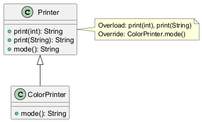

# Moduł 3.4: Nadpisywanie vs przeciążanie metod

## Wprowadzenie

`overload` i `override` to dwa różne mechanizmy, które studenci często mylą. `Overload` dotyczy wielu metod o tej samej nazwie w jednej klasie, a `override` dotyczy redefinicji zachowania odziedziczonego.

### Czego nauczysz się w tym module?
- jak odróżnić `overload` od `override`,
- jak JVM wybiera metodę przy przeciążaniu i nadpisaniu,
- dlaczego `@Override` powinno być standardem.

---

## Diagram koncepcji



Diagram PlantUML: [`diagrams/override_vs_overload.puml`](diagrams/override_vs_overload.puml)

---

## Kod i omówienie

Plik z przykładem:
- [`code/OverrideVsOverloadDemo.java`](code/OverrideVsOverloadDemo.java)

W przykładzie zobaczysz jednocześnie:
- przeciążanie metody po sygnaturze,
- nadpisanie metody z klasy bazowej,
- różnice widoczne na etapie kompilacji i uruchomienia.

### Dwa mechanizmy, dwa momenty decyzji

Przeciążanie jest wybierane przez kompilator na podstawie typów argumentów
widocznych w miejscu wywołania:

```java
void print(Animal animal) { ... }
void print(Dog dog) { ... }
```

Jeśli zmienna ma typ `Animal`, wybrane zostanie `print(Animal)`, nawet gdy
wskazuje na obiekt `Dog`.

Nadpisywanie dotyczy tej samej sygnatury odziedziczonej metody. Kompilator
sprawdza zgodność deklaracji, ale implementacja jest wybierana podczas
wykonania na podstawie rzeczywistego typu obiektu. Adnotacja `@Override` jest
ważna, bo kompilator wykrywa literówkę lub niezgodną sygnaturę.

Zmiana samego typu zwracanego nie tworzy overloadu. Przy override możliwy jest
natomiast kowariantny typ zwracany, czyli bardziej szczegółowy typ w potomku.

---

## Najczęstsze błędy

1. Traktowanie zmiany typu zwracanego jako przeciążania (to nie działa samodzielnie).
2. Literówki w nazwie metody przy `override` bez adnotacji `@Override`.
3. Oczekiwanie dynamicznego wyboru metody dla przeciążania (to decyzja kompilatora).

### Pytania kontrolne

- Który mechanizm działa na podstawie typu referencji: overload czy override?
- Dlaczego `@Override` warto stosować nawet wtedy, gdy kod bez niego się kompiluje?
- Czy dwie metody różniące się wyłącznie typem zwracanym mogą być overloadami?

---

## Uruchomienie

```powershell
Set-Location "C:\home\gitHub\oop-concepts-java\02_OOP\src\_03_dziedziczenie"
.\run-all-examples.ps1
```
