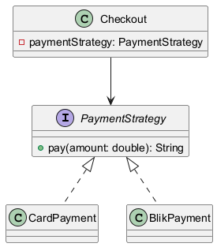

# Moduł 3.6: Polimorfizm i wzorce projektowe

## Wprowadzenie

Polimorfizm pozwala programować do abstrakcji, a nie do konkretnej klasy. To podstawa wielu wzorców projektowych, np. Strategy, gdzie zachowanie można podmieniać bez zmiany kodu klienta.

### Czego nauczysz się w tym module?
- jak wykorzystać polimorfizm do ograniczenia instrukcji warunkowych,
- jak działa wzorzec Strategy w praktyce,
- jak oddzielać kod klienta od implementacji szczegółów.

---

## Diagram koncepcji



Diagram PlantUML: [`diagrams/polymorphism_patterns.puml`](diagrams/polymorphism_patterns.puml)

---

## Kod i omówienie

Plik z przykładem:
- [`code/PolymorphismPatternsDemo.java`](code/PolymorphismPatternsDemo.java)

Fragment:

```java
Checkout checkout = new Checkout(new BlikPayment());
System.out.println(checkout.finalizeOrder(199.99));
```

Klasa `Checkout` nie zna szczegółów płatności. Zależy od abstrakcji, dzięki czemu łatwo dodać nową metodę płatności.

### Jak działa Strategy?

Wzorzec składa się z trzech elementów:

1. wspólny kontrakt, tutaj reprezentowany przez `Payment`,
2. kilka wymiennych implementacji, np. `BlikPayment`,
3. klasa kontekstu (`Checkout`), która używa kontraktu.

`Checkout` nie musi zawierać `if` dla każdej metody płatności. Zmiana strategii
następuje przy tworzeniu obiektu:

```java
Checkout checkout = new Checkout(new BlikPayment());
```

Można więc dodać `CardPayment` bez modyfikowania algorytmu finalizacji
zamówienia. To ogranicza ryzyko regresji i ułatwia testowanie - test może
wstrzyknąć prostą implementację testową.

Polimorfizm nie usuwa całej logiki warunkowej. Jest wartościowy wtedy, gdy
warianty mają wspólny kontrakt i mogą być wymieniane bez zmiany klienta.

---

## Najczęstsze błędy

1. Tworzenie dużych bloków `if/switch` zamiast polimorfizmu.
2. Łączenie logiki biznesowej i infrastrukturalnej w jednej klasie.
3. Brak testów kontraktowych dla wspólnego interfejsu.

### Pytania kontrolne

- Jaki element jest kontraktem strategii?
- Co trzeba zmienić, aby dodać nową metodę płatności?
- Czy wszystkie klasy implementujące `Payment` mogą być bezpiecznie użyte przez
  `Checkout`?

---

## Uruchomienie

```powershell
Set-Location "C:\home\gitHub\oop-concepts-java\02_OOP\src\_03_dziedziczenie"
.\run-all-examples.ps1
```
