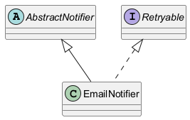

# Moduł 3.7: Klasy abstrakcyjne vs interfejsy

## Wprowadzenie

Klasa abstrakcyjna i interfejs rozwiązują podobny problem (abstrakcja), ale robią to inaczej. Klasa abstrakcyjna nadaje wspólny stan i część implementacji, a interfejs definiuje kontrakt i daje większą elastyczność.

### Czego nauczysz się w tym module?
- kiedy wybrać klasę abstrakcyjną,
- kiedy lepszy jest interfejs,
- jak łączyć oba podejścia w jednym projekcie.

---

## Diagram koncepcji



Diagram PlantUML: [`diagrams/abstract_vs_interface.puml`](diagrams/abstract_vs_interface.puml)

---

## Kod i omówienie

Plik z przykładem:
- [`code/AbstractVsInterfaceDemo.java`](code/AbstractVsInterfaceDemo.java)

W przykładzie porównano:
- wspólny stan i implementacje (klasa abstrakcyjna),
- kontrakt zachowania (interfejs),
- możliwość wielokrotnej implementacji interfejsów.

### Jak wybrać rozwiązanie?

Wybierz klasę abstrakcyjną, gdy typy mają wspólną tożsamość, stan lub
niezmienny fragment algorytmu. Klasa może rozszerzać tylko jedną klasę, więc
jest to silna relacja i powinna mieć znaczenie domenowe.

Wybierz interfejs, gdy chcesz opisać zdolność albo rolę, np. `Payable`,
`Closable` lub `Printable`. Klasa może implementować wiele interfejsów, dzięki
czemu jeden obiekt może pełnić kilka ról. Interfejs może zawierać metody
domyślne i statyczne, ale nie przechowuje stanu instancji.

W praktyce oba mechanizmy często współpracują: klasa abstrakcyjna dostarcza
wspólną implementację, a interfejs określa publiczny kontrakt używany przez
klienta.

---

## Najczęstsze błędy

1. Używanie klasy abstrakcyjnej tam, gdzie potrzebny jest tylko kontrakt.
2. Przechowywanie stanu w interfejsie (poza stałymi `public static final`).
3. Projektowanie klas bazowych, które wiedzą zbyt wiele o potomkach.

### Pytania kontrolne

- Czy potrzebujesz wspólnego stanu, czy tylko wspólnego zachowania?
- Czy typ powinien móc pełnić więcej niż jedną rolę?
- Czy klient powinien zależeć od klasy bazowej, czy od interfejsu?

---

## Uruchomienie

```powershell
Set-Location "C:\home\gitHub\oop-concepts-java\02_OOP\src\_03_dziedziczenie"
.\run-all-examples.ps1
```
