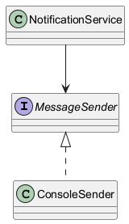

# Moduł 3.8: Abstrakcje, DI i wstrzykiwanie zależności

## Wprowadzenie

Wstrzykiwanie zależności działa najlepiej, gdy moduł wysokiego poziomu zależy od abstrakcji, a nie od konkretnej implementacji. Dziedziczenie i interfejsy są tu narzędziem do budowy luźno powiązanych komponentów.

### Czego nauczysz się w tym module?
- jak abstrakcja wspiera testowalność kodu,
- jak działa ręczne wstrzykiwanie zależności,
- jak przygotować kod pod kontenery DI.

---

## Diagram koncepcji



Diagram PlantUML: [`diagrams/di_abstraction.puml`](diagrams/di_abstraction.puml)

---

## Kod i omówienie

Plik z przykładem:
- [`code/DiAbstractionDemo.java`](code/DiAbstractionDemo.java)

Przykład pokazuje, jak ten sam komponent klienta może pracować z różną implementacją dostarczoną z zewnątrz.

### Trzy role w ręcznym DI

W najprostszym wariancie występują:

1. **abstrakcja** - interfejs opisujący potrzebne zachowanie,
2. **implementacja** - konkretna klasa wykonująca operację,
3. **klient** - klasa, która otrzymuje abstrakcję w konstruktorze.

Przykładowy schemat wygląda tak:

```java
ReportSender sender = new ConsoleReportSender();
ReportService service = new ReportService(sender);
```

`ReportService` nie tworzy sam `ConsoleReportSender`, więc nie jest związany
z jednym kanałem wysyłki. W teście można przekazać atrapę, a w aplikacji
produkcyjnej - implementację infrastrukturalną. Framework DI, taki jak Spring,
automatyzuje później tworzenie i łączenie obiektów, ale nie zmienia tej
podstawowej zasady.

Najczęściej zaczynamy od constructor injection, ponieważ zależność jest
wtedy jawna, a obiekt po utworzeniu ma komplet wymaganych współpracowników.

---

## Najczęstsze błędy

1. Tworzenie zależności (`new`) wewnątrz logiki biznesowej.
2. Wstrzykiwanie konkretnych klas zamiast interfejsów.
3. Brak testów jednostkowych dla komponentów korzystających z DI.

### Pytania kontrolne

- Kto powinien utworzyć implementację: klient czy kod konfigurujący aplikację?
- Jak przekazać do testu atrapę zależności?
- Dlaczego wstrzykiwanie konstruktorem ułatwia wykrycie brakującej zależności?

---

## Uruchomienie

```powershell
Set-Location "C:\home\gitHub\oop-concepts-java\02_OOP\src\_03_dziedziczenie"
.\run-all-examples.ps1
```
