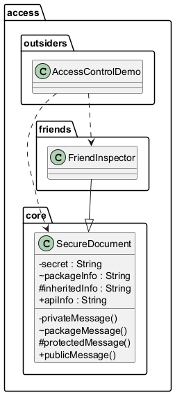

# 4.4 Kontrola dostępu do klas, pól i metod

## Po co to jest?

Pakiet to nie tylko nazwa; to rowniez granica widocznosci.
Modyfikatory dostepu okreslaja, kto moze uzywac elementu API.

- `private` - tylko wewnatrz klasy,
- brak modyfikatora - wewnatrz pakietu (package-private),
- `protected` - pakiet + klasy potomne,
- `public` - wszedzie.

`protected` wymaga dodatkowej ostrożności: klasa potomna z innego pakietu
może użyć składowej przez dziedziczenie, ale nie może traktować jej jak
zwykłego package-private elementu dowolnej instancji. Dlatego `protected`
jest narzędziem dla kontrolowanej rozszerzalności, a nie zamiennikiem
`public`.

### Tabela widoczności

| Modyfikator | Ta sama klasa | Ten sam pakiet | Podklasa w innym pakiecie | Dowolny pakiet |
|---|---:|---:|---:|---:|
| `private` | tak | nie | nie | nie |
| brak (`package-private`) | tak | tak | nie | nie |
| `protected` | tak | tak | tak, przez dziedziczenie | nie |
| `public` | tak | tak | tak | tak |

Najmniejszy zakres, który spełnia wymagania, jest zwykle najlepszym wyborem.
Zmniejsza liczbę zależności i utrudnia przypadkowe użycie szczegółów
implementacyjnych.

## Diagram



## Kod referencyjny

- [`code/core/SecureDocument.java`](code/core/SecureDocument.java)
- [`code/friends/FriendInspector.java`](code/friends/FriendInspector.java)
- [`code/outsiders/AccessControlDemo.java`](code/outsiders/AccessControlDemo.java)

Fragment (ograniczenia dostepu):

```java
// doc.packageMessage();   // blad: package-private
// doc.protectedMessage(); // blad: protected poza pakietem i bez dziedziczenia
```

Przykład rozdziela trzy sytuacje: dostęp z tej samej klasy, z zaprzyjaźnionej
klasy w tym samym pakiecie oraz z zewnętrznego pakietu. Komentarze z błędami
są celowe - po ich odkomentowaniu kompilator pokaże, że widoczność jest
sprawdzana na etapie kompilacji.

### Klasa publiczna a plik

W jednym pliku źródłowym może znajdować się najwyżej jedna publiczna klasa,
a nazwa pliku musi odpowiadać jej nazwie. Klasa package-private może być
ukrytym szczegółem implementacji pakietu i nie musi być dostępna dla klienta.

## Uruchomienie

```powershell
.\run-examples.ps1
```

## Literatura

- Oracle tutorial: Controlling Access: <https://docs.oracle.com/javase/tutorial/java/javaOO/accesscontrol.html>
- JLS 6.6 Access Control: <https://docs.oracle.com/javase/specs/jls/se21/html/jls-6.html#jls-6.6>

### Pytania kontrolne

- Który modyfikator wybrać dla szczegółu używanego tylko przez klasy pakietu?
- Czy `protected` udostępnia element każdej klasie w całej aplikacji?
- Dlaczego ograniczenie dostępu pomaga utrzymać API?
