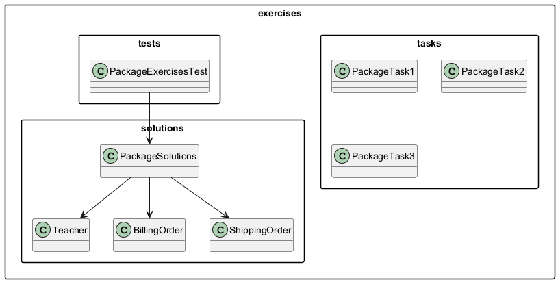

# Moduł 4.6: Zadania do samodzielnego rozwiązania

Sekcja utrwala materiał z modułów 4.1–4.5: przestrzenie nazw, definiowanie pakietów, CLASSPATH, kontrola dostępu, importy i kolizje nazw.

### Sposób pracy

W każdym zadaniu najpierw ustal kontrakt i strukturę katalogów, a dopiero
potem pisz klasy. Po utworzeniu pliku sprawdź trzy rzeczy:

1. czy deklaracja `package` odpowiada ścieżce;
2. czy importy wskazują właściwe typy;
3. czy kompilacja zapisuje wynik przez `-d` do katalogu, który później
   podajesz w `-cp`.

Zadania można rozwiązywać bez IDE. To celowe - pozwala zobaczyć, które
informacje dostarcza pakiet, które import, a które classpath.

---

## Diagram struktury rozwiązań



---

## Zadanie 1 ⭐ — Pierwszy pakiet (podstawowe)

**Kontekst:**
Tworzymy prosty system szkolny. Klasy muszą być zorganizowane w pakiety.

**Do wykonania:**

1. Utwórz pakiet `school.people` z klasą `Teacher`:
   ```java
   package school.people;
   public record Teacher(String name, String subject) {}
   ```

2. Utwórz pakiet `school.app` z klasą `SchoolApp` zawierającą metodę `main`.
   W metodzie `main` zaimportuj `Teacher`, utwórz dwa obiekty i wypisz ich dane.

3. Skompiluj ręcznie i uruchom:
   ```powershell
   javac --release 21 -d out src\school\people\Teacher.java src\school\app\SchoolApp.java
   java -cp out school.app.SchoolApp
   ```

**Oczekiwany wynik:**
```
Nauczyciel: dr Nowak, przedmiot: Matematyka
Nauczyciel: mgr Kowalski, przedmiot: Java
```

**Wskazówki:** patrz moduł 4.2 (struktura katalogów) i 4.5 (import).

**Sprawdzenie:** zmień nazwę pakietu albo przenieś plik do niewłaściwego
katalogu i zobacz, który etap zgłosi błąd. Następnie przywróć zgodność.

---

## Zadanie 2 ⭐⭐ — Kolizja nazw `Order`

**Kontekst:**
W systemie e-commerce mamy dwa niezależne podsystemy: płatności i wysyłka.
Oba definiują klasę `Order` z różnymi polami.

**Do wykonania:**

1. Utwórz `shop.billing.Order(String id, double amount)`.
2. Utwórz `shop.shipping.Order(String id, String destination)`.
3. W klasie `shop.reporting.OrderReport` utwórz metodę `printReport(...)`, która przyjmuje oba typy `Order` i wypisuje raport.
   Pamiętaj — nie możesz zaimportować obu jednocześnie; użyj FQN.

**Oczekiwany wynik:**
```
=== Raport zamówień ===
Płatność  B-01: 299.99 zł
Wysyłka   S-01: Kraków
```

**Wskazówki:** patrz moduł 4.5 (kolizje, FQN).

**Sprawdzenie:** spróbuj zaimportować obie klasy `Order` jednocześnie.
Wyjaśnij, dlaczego jedna z nich musi pozostać użyta przez FQN.

---

## Zadanie 3 ⭐⭐ — Kontrola dostępu

**Kontekst:**
Projektujemy klasę `BankAccount` z polami o różnym poziomie dostępu.

**Do wykonania:**

1. Utwórz pakiet `bank.core` z klasą `BankAccount`:
   - pole `private double balance` — saldo (niedostępne z zewnątrz bezpośrednio),
   - pole bez modyfikatora `String accountType` — widoczne tylko w pakiecie `bank.core`,
   - `protected void applyInterest(double rate)` — dla podklas,
   - `public double getBalance()` — publiczny getter,
   - `public void deposit(double amount)` — wpłata (waliduje kwotę > 0).

2. W pakiecie `bank.core` utwórz klasę `AuditService`, która może odczytać `accountType` (package-private).

3. W pakiecie `bank.premium` utwórz klasę `PremiumAccount extends BankAccount`:
   - nadpisz `applyInterest` — wyższe oprocentowanie (protected, widoczna przez dziedziczenie).

4. W pakiecie `bank.app` utwórz `BankApp` — klient, który widzi tylko `public`:
   ```java
   BankAccount acc = new PremiumAccount();
   acc.deposit(1000.0);
   System.out.println("Saldo: " + acc.getBalance());
   ```

**Oczekiwany wynik:**
```
Saldo: 1000.0
Odsetki naliczone (premium): 50.0
Saldo po odsetkach: 1050.0
```

**Wskazówki:** patrz moduł 4.4 (tabela modyfikatorów).

**Sprawdzenie:** odkomentuj wywołania oznaczone jako niedozwolone i zapisz,
z jakiego pakietu oraz z jakiego kontekstu nastąpił błąd.

---

## Zadanie 4 ⭐⭐⭐ — Static import i dokumentacja pakietu (zaawansowane)

**Kontekst:**
Tworzymy bibliotekę obliczeń geometrycznych.

**Do wykonania:**

1. Pakiet `geometry.shapes` z interfejsem `Shape`:
   ```java
   public interface Shape {
       double area();
       double perimeter();
   }
   ```

2. Pakiet `geometry.shapes` z klasami `Circle(double radius)` i `Rectangle(double width, double height)` implementującymi `Shape`.
   Użyj `import static java.lang.Math.PI` i `import static java.lang.Math.sqrt` w implementacjach.

3. W pakiecie `geometry.shapes` utwórz `package-info.java` z opisem Javadoc pakietu.

4. W pakiecie `geometry.app` utwórz `GeometryApp` z metodą `main`:
   - Utwórz listę `List<Shape>`, dodaj kilka figur.
   - Wypisz pole i obwód każdej.
   - Posortuj figury po polu (użyj `Comparator.comparingDouble(Shape::area)`).

**Oczekiwany wynik:**
```
Okrag r=5.0   pole=78.5398  obwod=31.4159
Prostokat 3x4 pole=12.0000  obwod=14.0000
--- posortowane po polu ---
Prostokat 3x4 pole=12.0000
Okrag r=5.0   pole=78.5398
```

**Wskazówki:** patrz moduł 4.2 (`package-info.java`), 4.5 (`import static`), moduł 02 (interfejsy, Comparator).

**Sprawdzenie:** wygeneruj Javadoc tylko dla `geometry.shapes` i sprawdź,
czy opis z `package-info.java` pojawia się w dokumentacji pakietu.

---

## Rozwiązania referencyjne

Gotowe rozwiązania znajdziesz w katalogu `solutions/`:

| Klasa | Pakiet |
|-------|--------|
| `Teacher.java` | `exercises.solutions` |
| `BillingOrder.java` | `exercises.solutions` |
| `ShippingOrder.java` | `exercises.solutions` |
| `PackageSolutions.java` | `exercises.solutions` |

## Testy weryfikacyjne

```powershell
.\run-examples.ps1
```

Wynik:

```
Prowadzacy: dr Nowak
B-10 + S-10
OK: PackageExercisesTest
```

---

## Wskazówki TDD

1. Zacznij od testu, który opisuje oczekiwane zachowanie.
2. Uruchom test — powinien się nie kompilować (czerwony).
3. Dodaj minimalny kod, który sprawi, że test przechodzi (zielony).
4. Zrefaktoryzuj nazwy pakietów i importy.
5. Uruchom test ponownie — powinien być zielony.

### Kryteria sukcesu

- każdy plik ma poprawną deklarację pakietu;
- kod kompiluje się z czystego katalogu wynikowego;
- program uruchamia się z poprawną pełną nazwą klasy;
- kolizje są rozwiązane jawnie, bez przypadkowego wildcard importu;
- zakres dostępu jest najmniejszy, który pozwala zrealizować wymaganie.
